<!-- Active banner palette: monochrome. Switch with python3 tools/animate_teejx.py --palette monochrome. -->

<picture>
  <source media="(prefers-reduced-motion: reduce)" srcset="assets/sections/hero-static.svg" />
  
</picture>

 

  &nbsp;
  &nbsp;
  &nbsp;
  

 

 

  &nbsp;
  

