 

<table border="0" cellpadding="14" cellspacing="0" bgcolor="#F0EEF6" width="100%">
  <tr>
    <td align="center">
      <b>Hey, I’m Teej.</b> 
      Computer Science student at National University — Manila 
      I build thoughtful web experiences, from responsive interfaces to full-stack features.
    </td>
  </tr>
</table>

## A little about me

I’m in my fourth year of BS Computer Science, focused on web development. I enjoy making interfaces feel clear and considered, then carrying that same care through the code behind them.

<table border="0" cellpadding="12" cellspacing="8" width="100%">
  <tr>
    <td bgcolor="#F0EEF6" width="50%"><b>What I enjoy</b> Full-stack web development · UI/UX · Responsive apps</td>
    <td bgcolor="#F0EEF6" width="50%"><b>How I work</b> Curious by default · Detail-minded · Always learning</td>
  </tr>
</table>

## My toolkit

<table border="0" cellpadding="12" cellspacing="8" width="100%">
  <tr>
    <td bgcolor="#F0EEF6" align="center" width="50%"><b>Languages</b> </td>
    <td bgcolor="#F0EEF6" align="center" width="50%"><b>Frontend</b> </td>
  </tr>
  <tr>
    <td bgcolor="#F0EEF6" align="center" width="50%"><b>Backend</b> </td>
    <td bgcolor="#F0EEF6" align="center" width="50%"><b>Data & tools</b> </td>
  </tr>
</table>

## Around GitHub

 

## Say hello

